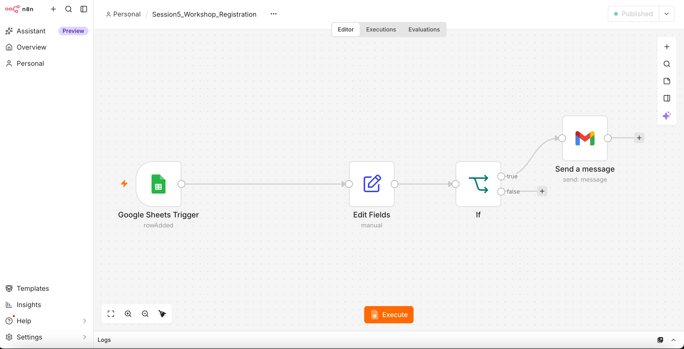
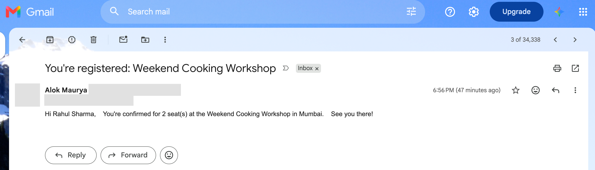

# Self-cleaning registration pipeline

**One line:** An automation that takes messy sign-ups from a Google Form, cleans and validates every field, flags what it can't fix, and sends a confirmation email only when the contact details are usable.

| | |
| --- | --- |
| **Domain** | Events / customer onboarding |
| **AI technique** | Data operations (validation, cleaning, flagging): the step every AI pipeline depends on |
| **Tools** | n8n (self-hosted on Docker Desktop), Google Forms, Google Sheets, Gmail |
| **Built** | Session 5, 14 Oct 2026 |
| **Headline result** | Live, hands-off pipeline: a new form entry is cleaned and confirmed within about a minute; invalid emails are held back instead of bouncing |

## 1. The business problem
People type the same thing many different ways. In a weekend cooking-workshop sign-up, three test entries already showed: extra spaces and random capitals in names, upper-case emails, a blank phone number, a 5-digit "mobile", an email with no domain ending, and "two" typed into a number field. Any system that uses this data (a confirmation email, a CRM, a model) inherits the mess. Bad contact data means missed confirmations, bounced emails and no-shows.

## 2. Why this approach (and why no AI yet)
Every problem here has a clear rule: trim spaces, fix capitals, keep digits only, check the email pattern, check a phone has 10 digits. Rules are cheaper, faster and fully predictable, so no model is needed. The bigger lesson: **the cheapest cleaning is the data you never let in.** The next step is form validation at the source (dropdown for seats, phone and email checks), with cleaning as the safety net for whatever still slips through.

## 3. Data
Google Form responses linked to a Google Sheet: timestamp, full name, email, phone (optional), city, seats. Test data was deliberately messy. Test emails used plus-addressing (`me+tag@gmail.com`) so no real person was emailed during testing.

## 4. How it works

1. **Trigger:** Google Sheets Trigger checks every minute for a new row.
2. **Clean (Edit Fields):** trims and title-cases names and cities, lower-cases emails, strips non-digits from phones, converts seats to a number.
3. **Flag, don't delete:** adds `email_valid`, `phone_missing`, `phone_valid` and `seats_needs_check`, so problems stay visible instead of disappearing.
4. **Check (If):** only rows with a valid email continue.
5. **Act (Gmail):** sends a personalised confirmation using the cleaned name, city and seats.

## 5. Results

| Test | Outcome | What it means |
| --- | --- | --- |
| 3 messy test rows | 2 confirmations sent with correctly formatted names; the row with `ankit@yahoo` held back | Bad emails never reach the send step |
| "two" in Seats | Caught by n8n's type check; converted to 0 and flagged | Bad input fails loudly or gets flagged, never passes silently |
| Live 4th form entry | Cleaned and confirmed automatically, no manual step | Runs unattended |

*Input name was typed as `  RAHUL Sharma  ` and city as `mumbai`; the email shows the cleaned values.*

## 6. Product decisions I made
- **Flag instead of delete:** a blank phone or odd seat count is kept and marked, because "missing" can itself be information and deleting it hides problems.
- **Gate the irreversible action:** emails go out only after validation. In automation, testing an action step does the real action, so the send step is disabled while testing.
- **Prevent before cleaning:** recommended form-level validation (dropdowns, required fields, format rules) as the first fix, with pipeline cleaning as the backstop.

## 7. Risks and checks
- **Silent breakage:** a renamed column (`Full name` vs `Full Name`) blanked a field during the build. In production this needs monitoring: an alert when a flag rate jumps or a field comes through empty.
- **Training–serving consistency:** the same cleaning must run on every new entry exactly as it did on test data. One shared pipeline guarantees that.
- **Privacy:** contact data stays in the organiser's own Google account; test runs used self-owned addresses only.
- **Credential expiry:** Google OAuth in testing mode expires roughly weekly; a failed run needs a reconnect, so failures must be visible.

## 8. What I'd do next
1. Move validation into the form itself: seats as a 1–4 dropdown, a 10-digit mobile rule, an email format check.
2. Write cleaned rows to a separate "Clean" tab and send flagged rows to an organiser for follow-up.
3. Add a daily summary: entries received, % flagged by type. That's a simple data-quality dashboard.

## Files
- `workflow/` — exported n8n workflow (.json); Google Sheet ID and credential references removed, so set your own sheet and credentials after import
- `images/` — workflow screenshot and a sample confirmation email (addresses redacted)
- `data/` — sample (anonymised) test rows
