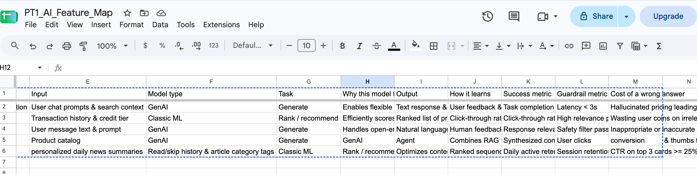

# AI features teardown: 5 apps on my phone

**One line:** A product teardown of five AI features I use every week, mapping each one's input, model type, output, learning signal, success metric, guardrail and cost of a wrong answer.

| | |
| --- | --- |
| **Domain** | Travel, fintech, messaging, e-commerce, media |
| **AI technique** | Classifying features by model type (rules, classic ML, deep learning, GenAI, agents) and task (classify, predict, rank, generate, act) |
| **Tools** | Google Sheets (with dropdown validation), Google AI Studio (Gemini) for critique |
| **Built** | Practical Test 1, Session 6, 15 Oct 2026 |
| **Headline result** | Passed (62/100). Five features across five industries, a reasoned push-back on an AI critique, and a shippable improvement for Amazon Rufus |

## 1. The business problem
Most PMs say "the app uses AI" without being able to say what kind, what it learns from, or how anyone would know it works. Before you can spec, price or de-risk an AI feature, you need to name its parts. This teardown practises that on real products.

## 2. Why this approach
Each feature is mapped on the same 13 columns. The **model type** column is a dropdown that rejects free text (Rules / Classic ML / Deep learning / GenAI / Agent), so the map stays consistent. The test rule: pick the **simplest stage that works**, and justify it in one line.

## 3. Data
My own phone: MakeMyTrip, CRED, WhatsApp, Amazon and Inshorts. The full map is in [`data/feature-map.csv`](data/feature-map.csv).

## 4. The map

| App | Feature | Model type · Task | Input → Output | Success metric | Guardrail |
| --- | --- | --- | --- | --- | --- |
| MakeMyTrip | Myra AI trip assistant | GenAI · Generate | Chat prompts, search filters, past bookings, live inventory → text + booking widgets | Task completion ≥ 75%, rolling 7 days, min 5,000 chats† | Latency < 3 s |
| CRED | Store product recommendations | Classic ML · Rank | Transaction history, credit tier → ranked product cards | CTR ≥ 8%, rolling 4 weeks, min 50,000 users† | Precision at top 5 |
| WhatsApp | Ask Meta AI | GenAI · Generate | Message text → text or image | Rater-judged relevance ≥ 85%, weekly, per language† | Safety-filter pass rate 99.9% |
| Amazon | Rufus shopping assistant | GenAI (Agent once it acts) · Generate | Product catalogue via RAG + tool calls → comparison text + carousels | Rufus-assisted order rate vs no-Rufus A/B†| Return rate of Rufus orders not higher†|
| Inshorts | Personalised news feed | Classic ML · Rank | Read/skip history, category tags → ranked 60-word cards | D7 retention ≥ 40%, rolling 4 weeks† | CTR on top 3 cards ≥ 25% |

*The sheet as submitted. Rows 5 (Rufus) and 6 (Inshorts) had cells shifted right; the table above and the CSV are the corrected version.*

† Completed after the tutor review: the window, exclusions and minimum data for each success metric, plus the Rufus guardrail and the missing cost-of-error cells for Rufus and Inshorts. Everything else is as submitted.

## 5. Results

| Area | Score | What it means |
| --- | --- | --- |
| Working output | 24 / 40 | All five features and every mix rule met; two rows needed realigning after paste |
| Right method | 19 / 30 | Sensible model type and task for every feature |
| Business interpretation | 19 / 30 | Strong cost-of-error thinking and Part C; metrics needed all five parts |
| **Total** | **62 / 100** | Pass (bar: 60) |

## 6. Product decisions I made
- **Pushed back on the AI critique.** Gemini said a Myra pricing error creates payment and liability risk. I argued that prices shown in booking widgets come from the same live system, so they can't drift. Review refined it: widget prices are safe, but anything the LLM *writes in text* (a fare from an earlier turn, a refund rule) can be wrong, as the Air Canada chatbot ruling showed.
- **The feature I'd own: Amazon Rufus.** Ship "compare the top 3 and add the best to cart" through tool calling. Measure cart additions per Rufus session (+15% target) with cart abandonment and **return rate** held flat, so we don't drive misinformed purchases. To make it production-ready: test it as an A/B experiment, count orders not just cart adds, and never add to cart without the shopper's confirmation.

## 7. Risks and responsible-AI checks
- **Hallucination:** GenAI facts (prices, policies) must come from tools, not model memory.
- **Gaming:** a guardrail must catch what a team could do to inflate the main metric, e.g. clickbait in a news feed or high-margin items in a rewards store.
- **Acting on a user's behalf:** once Rufus adds to cart it is an agent, and every action needs explicit consent.

## 8. What I learned / what I'd do next
1. **A metric has five parts**: metric, threshold, window, exclusions, minimum data. My first drafts had only two.
2. **A guardrail is not a second success metric.** Precision@5 (CRED) and top-3 CTR (Inshorts) measure success; better guardrails would be the share of high-margin-only recommendations and the share of sensational stories in the top 3.
3. **"How it learns" is the label for one item** (read the card vs swiped past), not a business KPI like retention.
4. Next map: widen the range beyond chatbots, adding vision (Google Lens), number prediction (a delivery ETA) and a rules feature (UPI daily limit). The model-answer workbook below includes all three.

## Files
- [`images/feature-map-as-submitted.png`](images/feature-map-as-submitted.png): the Google Sheet as submitted (rows 5–6 had shifted columns; the corrected map is in the CSV)
- [`data/feature-map.csv`](data/feature-map.csv): my completed feature map († = completed after review)
- [`data/PT1_Model_Answers.xlsx`](data/PT1_Model_Answers.xlsx): tutor model answers, a 7-question method for analysing any industry, an industry cheat-sheet and a metric-builder template

*Note: I used an AI assistant to sharpen my reasoning on the Part C product idea; the feature choices and map are my own.*
